# Model-Based VPI Defenses: A Deep-Dive Monograph on Model-Level & Representation Guardrails Against Visual Prompt Injection

[](LICENSE)
[](docs/)
[-orange.svg)](docs/)
[](docs/)

> **A Study Monograph and Technical Repository**  
> Dissecting the algorithmic foundations, mathematical formulations, internal latent representations, auxiliary guardrail architectures, and empirical trade-offs of **Model-Based Defenses against Visual Prompt Injection (VPI)** in Vision-Language Models (VLMs) and Multimodal Autonomous Agents.

---

## 🎯 Executive Overview & Scope Delimitation

The rapid adoption of Vision-Language Models (VLMs) and Computer-Use Agents (CUAs)—from commercial GPT, Claude and Gemini models to open-weight models like Qwen2.5-VL and LLaVA—has exposed a fundamental vulnerability: **Visual Prompt Injection (VPI)**. By embedding adversarial directives into images, PDFs, CSS overlays, or web screenshots, attackers bypass safety boundaries, hijack agent execution paths, and trigger unauthorized mutations.

In response, the AI security research community has produced a rich spectrum of defenses. This repository provides a deep-dive study of **strictly Model-Based Defenses**:

```
                                  DEFENSE TAXONOMY
                                          │
            ┌─────────────────────────────┴─────────────────────────────┐
            ▼                                                           ▼
┌───────────────────────────────────────┐   ┌───────────────────────────────────────┐
│       STRICTLY MODEL-BASED            │   │      SYSTEM & SOFTWARE ENGINEERING    │
│       (Covered in this Repo)          │   │         (Deliberately Excluded)       │
├───────────────────────────────────────┤   ├───────────────────────────────────────┤
│ • Multimodal Safety Fine-Tuning       │   │ • Dual-LLM Privilege Separation       │
│   (VLGuard, Cross-Modal SFT)          │   │   (CaMeL, CaMeL-CUA)                  │
│ • Latent Representation Interventions │   │ • Information Flow Control (IFC)      │
│   (SafePTR Token Pruning, ARGUS)      │   │   (FIDES, The LLMbda Calculus)        │
│ • Discrete Bottlenecks & Codebooks    │   │ • Deterministic Privilege DSLs        │
│   (Q-MLLM Vector Quantization)        │   │   (Progent with Z3 SMT Solvers)       │
│ • Auxiliary VLM Guardrails & Watchers │   │ • Trusted Computing Bases (TCB)       │
│   (WARD, Llama Guard 3V, LlavaGuard)  │   │   (Reference Monitors, Nonce Tokens)  │
│ • Chain-of-Thought Reasoning Guards   │   │ • Sandboxed Filesystem / Network Gating│
│   (GuardReasoner-VL, SafeGuard-VL)    │   │   (Playwright Shims, Egress Traps)    │
└───────────────────────────────────────┘   └───────────────────────────────────────┘
```

---

## 📊 Interactive Showcase Visualizations (Archify Standalone Artifacts)

This repository includes two interactive visual architectures generated with the Archify engine (self-contained HTML files; download and open locally in a browser, since GitHub does not render `.html`):

1. **[Taxonomy & Architecture Map](visualizations/model-defense-taxonomy.html):** Interactive map dissecting internal representation defenses (quantization, pruning, activation steering) versus auxiliary guardrail models.
2. **[End-to-End Execution Pipeline](visualizations/model-defense-pipeline.html):** Multi-lane operational workflow illustrating the observation intake, representation filtering, guardrail oversight, and core VLM actuation.

---

## 📚 Curriculum & Chapter Guide

The complete monograph is authored in academic Vietnamese, structured into 9 comprehensive chapters:

| Chapter | Title & Target Papers | Core Technical Mechanism | Key Venue & Year |
|:---:|:---|:---|:---:|
| **[00](docs/00_tong_quan_va_ly_thuyet_model_based_defense.md)** | **Bức Tranh Toàn Cảnh & Nền Tảng Lý Thuyết** | Multimodal semantic misalignment, attention hijacking, taxonomic boundary definition | Foundations |
| **[01](docs/01_vlguard_safety_finetuning.md)** | **VLGuard: Safety Fine-Tuning** | Multimodal safety fine-tuning, catastrophic forgetting prevention, dual-objective loss formulation | **ICML 2024** |
| **[02](docs/02_safeptr_prune_then_restore.md)** | **SafePTR: Prune-then-Restore** | Token-level jailbreak mitigation, sensitive layer discovery, Benign Feature Restoration (BFR) | **NeurIPS 2025** |
| **[03](docs/03_argus_activation_steering.md)** | **ARGUS: Activation Steering** | Subspace latent activation steering ($h' = h + \alpha v_{\text{safe}}$), on-demand linear probes | **CVPR 2026 (Oral)** |
| **[04](docs/04_ward_web_agent_robust_defense.md)** | **WARD: Web Agent Robust Defense** | Asynchronous parallel inspection (0.8B/2B), A3T adversarial training, zero added latency | **ICML 2026** |
| **[05](docs/05_guard_models_llama_guard_va_llavaguard.md)** | **Llama Guard 3 Vision & LlavaGuard** | Auxiliary VLM guardrails, 13 hazard categories, guided rationales, policy exception scores | **Meta / ICML 2025** |
| **[06](docs/06_guardreasoner_vl_va_safeguard_vl_cot_reasoning.md)** | **GuardReasoner-VL & SafeGuard-VL** | Multimodal Chain-of-Thought (CoT) reasoning, Online RL with dynamic clipping GRPO, RLVR | **NeurIPS 2025 / CVPR 2026** |
| **[07](docs/07_qmllm_va_discrete_representation_defenses.md)** | **Q-MLLM & Discrete Representations** | Two-level vector quantization codebooks, disrupting continuous gradient feedback, token masking | **NDSS 2026 / ICML 2026** |
| **[08](docs/08_so_sanh_thuc_nghiem_va_ranh_gioi_that_bai.md)** | **Ma Trận Thực Nghiệm & Ranh Giới Thất Bại** | 7D technical comparison matrix, 5 fatal failure modes, defense-in-depth hybrid architecture | Synthesis & Frontier |
| **[09](docs/09_tai_lieu_mo_rong_top_tier.md)** | **Extended Literature Map (A/A\* Venues & Big Tech)** | Annotated bibliography with verification level: fine-tuning, representation-level, guard models, inference-time defenses, benchmarks | USENIX Sec 2025, CCS 2025, ICLR 2025/2026, NeurIPS 2024, ECCV 2024, Google, Meta |
| **[10](docs/10_gemini_adversarial_training_google_deepmind.md)** | **Gemini Adversarial Training (Google DeepMind)** | Adversarial fine-tuning against indirect prompt injection, adaptive red-teaming, layered defense | **Google DeepMind 2025** |
| **[11](docs/11_secalign_struq_va_instruction_hierarchy.md)** | **StruQ, SecAlign, ISE & Instruction Hierarchy** | Structured queries, DPO-based preference optimization, instructional segment embeddings | **USENIX Sec 2025 / CCS 2025 / ICLR 2025** |
| **[12](docs/12_circuit_breakers_representation_rerouting.md)** | **Circuit Breakers (Representation Rerouting)** | Rerouting harmful representations via LoRA, multimodal experiment on LLaVA-NeXT | **NeurIPS 2024** |
| **[13](docs/13_webagentguard_snapguard_va_so_sanh_ward.md)** | **WebAgentGuard, SnapGuard vs. WARD** | Reasoning-driven web-agent guards, VPI-Bench as neutral yardstick | **ICML 2026 / preprints** |

---

## 📑 Dedicated Paper Series Subfolders (`papers/`)

Similar to the multi-document deep dives for CaMeL and VPI-Bench, this repository provides dedicated subfolders containing comprehensive multi-chapter monographs for each individual landmark paper:

| Paper Series | Subfolder | Documents Included | Focus & Scope |
|:---|:---|:---:|:---|
| **VLGuard** (ICML 2024) | [`papers/vlguard/`](papers/vlguard/) | 5 Documents | Multimodal Safety Duality, Dataset Engine, Loss Balancing, Empirical Benchmarks, Failure Boundaries |
| **SafePTR** (NeurIPS 2025) | [`papers/safeptr/`](papers/safeptr/) | 5 Documents | 1% Token Paradox, Layer Sensitivity, Harmful Token Pruning, Benign Features Restoration, GUI Blindspots |
| **ARGUS** (CVPR 2026) | [`papers/argus/`](papers/argus/) | 5 Documents | Latent Subspace Probing, Closed-Form Adaptive Steering $\alpha_o$, Multimodal IPI Defense, DPO Comparison |
| **WARD** (ICML 2026) | [`papers/ward/`](papers/ward/) | 5 Documents | Web Agent Threat Surface, PIG Vulnerability, Asynchronous Parallel Watcher, A3T Training, WARD-Base/WebArena |
| **Q-MLLM & GTM** (NDSS / ICML 2026) | [`papers/qmllm/`](papers/qmllm/) | 5 Documents | Continuous Gradient Exploitation, Two-Level VQ Bottleneck, Voronoi Cells, Gradient-Guided Token Suppression |
| **VLM Guardrails & CoT** | [`papers/guard_models/`](papers/guard_models/) | 5 Documents | Llama Guard 3V, LlavaGuard, GuardReasoner-VL CoT Reasoning, SafeGuard-VL Policy-Adaptive RLVR, Latency Trade-offs |

---

## 🔬 7D Technical Comparison Matrix

A comparison of the 8 core systems studied in Chapters 1 to 7 (LlavaGuard and GTM are covered alongside Llama Guard 3V and Q-MLLM respectively) across seven dimensions. Figures are those reported by each paper's authors and quoted in the chapter indicated; the full matrix with sources is in [Chapter 8](docs/08_so_sanh_thuc_nghiem_va_ranh_gioi_that_bai.md). Benchmarks differ between papers, so rows are not directly comparable.

| Defense System | Venue | D1 Intervention Level | D2 White/Black-box | D3 Latency Overhead | D4 Utility Impact | D5 Meta-Injection Resilience | D6 Multi-Turn Awareness | D7 Enforcement Logic |
|:---|:---:|:---|:---:|:---|:---|:---:|:---:|:---|
| **VLGuard** | ICML 2024 | Decoder / Projector weights (SFT) | White-box | No extra calls at inference | No measurable loss (Ch. 1) | ⚠️ New jailbreaks | ❌ Stateless | Soft logits |
| **SafePTR** | NeurIPS 2025 | Intermediate hidden tokens | White-box | +0.8% to +4.2% (Ch. 2) | MME 1503.6 → 1538.1 (Ch. 2) | ⚠️ Diffused payloads | ❌ Stateless | Semantic-distance threshold |
| **ARGUS** | CVPR 2026 | Hidden-subspace activations | White-box | +3 to 6 ms (Ch. 3) | UIA mostly preserved (Ch. 3) | ⚠️ Direction-shifting injections | ❌ Stateless | Steering $a_l - \alpha_o w_l$ |
| **WARD** | ICML 2026 | Compact watcher (0.8B/2B) | **Black-box compatible** | Parallel; not on critical path (Ch. 4) | FPR ≈ 0.25% (Ch. 4) | ✅ A3T-trained | ⚠️ Per-step | Short reasoning, then binary verdict |
| **Llama Guard 3V** | Meta 2024 | Auxiliary VLM (11B) | **Black-box compatible** | One extra guard pass per check (Ch. 5) | None on main VLM | ❌ 0.00% recall on web VPI (Ch. 4) | ❌ Stateless | 13 hazard categories |
| **GuardReasoner-VL** | NeurIPS 2025 | Auxiliary CoT VLM | **Black-box compatible** | ~208 tokens, ~1.85 s (Ch. 6) | None on main VLM | ❌ 0.00% recall on web VPI (Ch. 4) | ❌ Stateless | Reasoning chain + verdict |
| **SafeGuard-VL** | CVPR 2026 | Policy-adaptive VLM | **Black-box compatible** | ~250 to 400 tokens, ~2.1 s (Ch. 6) | None on main VLM | ⚠️ Not evaluated on VPI | ❌ Stateless | RLVR verifiable rewards |
| **Q-MLLM** | NDSS 2026 | Discrete VQ codebook | White-box | +2.1% (Ch. 7) | ScienceQA −1.4 (Ch. 7) | ⚠️ BPDA / STE can bypass (Ch. 7) | ❌ Stateless | Codebook indices |

---

## ⚠️ The 5 Fatal Failure Modes of Pure Model-Based Defenses

This literature review indicates that while model-based defenses significantly depress Attack Success Rates on static single-turn benchmarks, **they cannot provide complete security for autonomous computer-use agents** due to five structural bottlenecks:

1. **The "Guard Jailbreak" Paradox (Meta-Injections):** Guard models are neural networks; adversarial payloads crafted to deceive the evaluator (e.g., prompt-in-prompt disguise) can sharply reduce detection recall; WARD reports that general-purpose guards reach 0.00% recall on its web VPI benchmarks (Chapter 4).
2. **Multi-Turn Trajectory Blindness:** All examined model defenses evaluate inputs statelessly at step $t$. They have no cryptographic memory of the original user contract at $t=0$, rendering them blind to *Latent Multi-Turn VPI* at $t \ge 3$.
3. **GUI Utility Collapse:** Token pruning, continuous smoothing, and discrete quantization blur fine visual details (small icons, form fields, financial tables), degrading agent navigation precision.
4. **Latency & Cost Multiplication:** Sequential guardrails add at least one extra model call per checked step; reported guard latencies range from ~0.1 s to ~2 s per call depending on model and setup (Chapters 5 and 6).
5. **Closed-API Incompatibility:** Weight fine-tuning, activation steering, and token pruning require white-box parameter access, making them impossible to deploy on commercial closed frontier models (GPT, Claude, Gemini).

---

## 🛡️ The Frontier: Defense-in-Depth Hybrid Architecture

The conclusion of this monograph: **Model-based defenses reduce perception contamination, but only system-level architectural gating can guarantee uncircumventable execution safety.**

```mermaid
flowchart LR
    subgraph PERCEPTION["Tier 1: Representation Filtering (Model-Based)"]
        direction TB
        RawPixels["Raw GUI Screenshot"] --> VQ_Prune["Q-MLLM Codebook / SafePTR Pruning"]
        VQ_Prune --> TypedFacts["Typed Fact Extraction (JSON Schema)"]
    end

    subgraph REASONING["Tier 2: Agent Planning (Untrusted VLM)"]
        direction TB
        TypedFacts --> AgentVLM["Frontier VLM (GPT-4o / Claude / Qwen)"]
        AgentVLM --> ActionProposal["Action Proposal: {tool, args}"]
    end

    subgraph SYSTEM["Tier 3: System-Level TCB Gating (Deterministic)"]
        direction TB
        ActionProposal --> TCB_Gate["TCB Authorization Interceptor"]
        TCB_Gate -->|Matches Intent at t=0| NonceToken["Single-Use HMAC Nonce Token"]
        TCB_Gate -->|Violation Detected| Deny["Fail-Closed Security Abort"]
        NonceToken --> Actuator["Playwright / OS Actuator"]
    end

    style PERCEPTION fill:#eff6ff,stroke:#2563eb,stroke-width:2px
    style REASONING fill:#fefce8,stroke:#ca8a04,stroke-width:2px
    style SYSTEM fill:#f0fdf4,stroke:#16a34a,stroke-width:2px
```



---

## 📖 Citation & Academic Attribution

```bibtex
@misc{model_based_vpi_defenses_2026,
  author = {Vo Pham Tuan Dung},
  title = {Model-Based VPI Defenses: A Deep-Dive Monograph on Model-Level and Representation Guardrails Against Visual Prompt Injection},
  year = {2026},
  publisher = {GitHub},
  howpublished = {\url{https://github.com/tuandung222/model-based-vpi-defenses}}
}
```

