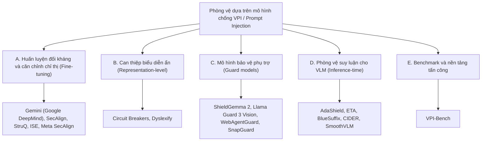

[⬅️ Chương trước: Ma Trận Đối Soát & Ranh Giới Thất Bại](08_so_sanh_thuc_nghiem_va_ranh_gioi_that_bai.md) | [🏠 Mục Lục](../README.md) | [Chương tiếp: Gemini Adversarial Training ➡️](10_gemini_adversarial_training_google_deepmind.md)

---

# Chương 9: Thư Mục Tài Liệu Mở Rộng (Hội Nghị A/A\* và Big Tech) Về Phòng Vệ Dựa Trên Mô Hình Chống VPI

> **Mục đích:** Chương 1 đến 7 phân tích sâu 8 hệ thống cốt lõi. Chương này bổ sung các công trình liên quan từ **hội nghị hạng A/A\*** (NeurIPS, ICML, ICLR, CVPR, ECCV, ACL, USENIX Security, ACM CCS, NDSS) và từ **phòng nghiên cứu của Big Tech** (Google DeepMind, Google, Meta, OpenAI, Microsoft), kèm cách chúng liên hệ với phần đã học.
>
> **Quy ước xác minh:** Venue và mã arXiv trong chương này được đối chiếu với trang chính thức của hội nghị hoặc arXiv tại thời điểm biên soạn (10/2026). Cột "Mức xác minh" cho biết còn điều gì cần kiểm tra lại. Với các bài đánh dấu "preprint", **chưa có bằng chứng về việc được nhận đăng**; không nên trích như bài hội nghị.

---

## 1. Cách Đọc Bản Đồ Tài Liệu

Phạm vi của chuyên khảo là **phòng vệ ở mức mô hình** (model-based): thay đổi trọng số, biểu diễn ẩn hoặc dùng một mô hình bảo vệ phụ trợ. Tài liệu mở rộng được chia thành năm nhóm:

---

## 2. Nhóm A: Huấn Luyện Đối Kháng và Căn Chỉnh Phân Cấp Chỉ Thị

| Công trình | Đơn vị | Venue / Năm | Mã | Ý tưởng cốt lõi | Mức xác minh |
|:---|:---|:---:|:---:|:---|:---|
| **Lessons from Defending Gemini Against Indirect Prompt Injections** | Google DeepMind | Báo cáo kỹ thuật (white paper), 05/2025 | arXiv:2505.14534 | Tinh chỉnh đối kháng (adversarial fine-tuning) Gemini 2.5 kết hợp red-teaming tự động thích ứng; phòng thủ nhiều tầng | Venue: đã xác minh là white paper arXiv. Số liệu chi tiết: xem [Chương 10](10_gemini_adversarial_training_google_deepmind.md) |
| **StruQ: Defending Against Prompt Injection with Structured Queries** | UC Berkeley | **USENIX Security 2025** | arXiv:2402.06363 | Tách kênh lệnh và dữ liệu bằng định dạng có cấu trúc và tinh chỉnh StruQ trên các ví dụ chèn lệnh mô phỏng | Đã xác minh trang USENIX |
| **SecAlign: Defending Against Prompt Injection with Preference Optimization** | UC Berkeley, Meta FAIR | **ACM CCS 2025** | arXiv:2410.05451 | Dùng tối ưu hóa ưu tiên (DPO) để mô hình ưu tiên phản hồi theo chỉ thị hợp lệ thay vì chỉ thị chèn | Đã xác minh (DOI 10.1145/3719027.3744836). Xem [Chương 11](11_secalign_struq_va_instruction_hierarchy.md) |
| **Meta SecAlign: A Secure Foundation LLM Against Prompt Injection Attacks** | Meta | Preprint, 2025 (cập nhật 2026) | arXiv:2507.02735 | Mô hình nền tảng open-weight (8B, 70B) được huấn luyện chống chèn lệnh | Chưa xác minh được venue; coi là preprint |
| **Instructional Segment Embedding (ISE)** | Princeton và cộng sự | **ICLR 2025** | arXiv:2410.09102 | Thêm embedding phân đoạn (system / user / data / output) vào kiến trúc để mã hóa phân cấp chỉ thị | Đã xác minh trang ICLR |
| **The Instruction Hierarchy** | OpenAI | Preprint, 2024 | arXiv:2404.13208 | Huấn luyện LLM ưu tiên chỉ thị đặc quyền cao hơn chỉ thị đến từ nguồn kém tin cậy | Chỉ xác minh sự tồn tại; venue chưa kiểm tra |
| **Defending Against Indirect Prompt Injection Attacks With Spotlighting** | Microsoft | Preprint, 2024 | arXiv:2403.14720 | Phòng vệ ở mức prompt: delimiting, datamarking, encoding để mô hình phân biệt nguồn đầu vào | Prompt-level, không phải model-based; đưa vào để làm mốc so sánh |
| **Defending Against Prompt Injection With a Few DefensiveTokens** | (xem arXiv) | Preprint | arXiv:2507.07974 | Học một vài token phòng vệ thay vì huấn luyện toàn mô hình | Chưa đọc chi tiết; chỉ xác minh tồn tại |

**Liên hệ với chuyên khảo:** Nhóm A là họ hàng gần của VLGuard (Chương 1): đều là huấn luyện để mô hình phân biệt lệnh hợp lệ với lệnh tiêm. Khác biệt là nhóm A làm trên văn bản (LLM), còn VLGuard và ARGUS nhắm vào đầu vào đa phương thức. Đây là khoảng trống nghiên cứu: các kỹ thuật như SecAlign (DPO) hầu như chưa được đánh giá có hệ thống trên VPI từ ảnh.

---

## 3. Nhóm B: Can Thiệp Biểu Diễn Ẩn

| Công trình | Venue / Năm | Mã | Ý tưởng cốt lõi | Mức xác minh |
|:---|:---:|:---:|:---|:---|
| **Improving Alignment and Robustness with Circuit Breakers** (Zou và cộng sự, Gray Swan AI / CMU) | **NeurIPS 2024** | arXiv:2406.04313 | "Định tuyến lại biểu diễn" (Representation Rerouting) để ngắt quá trình sinh nội dung có hại; có thí nghiệm đa phương thức trên LLaVA-NeXT-Mistral-7B | Đã xác minh trang NeurIPS. Xem [Chương 12](12_circuit_breakers_representation_rerouting.md) |
| **Dyslexify: A Mechanistic Defense Against Typographic Attacks in CLIP** (Hufe và cộng sự) | **ICLR 2026** | arXiv:2508.20570 | Xác định các attention head mang thông tin chữ và loại bỏ chúng (không cần huấn luyện), giảm tác dụng của tấn công typographic trên CLIP | Đã xác minh trang tổng hợp ICLR 2026; chưa đọc toàn văn |
| **Steering CLIP's Vision Transformer with Sparse Autoencoders** | Preprint | arXiv:2504.08729 | Dùng sparse autoencoder để điều hướng ViT của CLIP; phòng vệ typographic là một ứng dụng | Chỉ xác minh tồn tại |
| **Safeguarding Vision-Language Models Against Patched Visual Prompt Injectors** (SmoothVLM) | Preprint, 2024 | arXiv:2405.10529 | Làm trơn ngẫu nhiên (randomized smoothing) trên pixel và bỏ phiếu đa số; báo cáo ASR dưới 5% trên LLaVA-1.5 và MiniGPT-4 | Venue chưa xác minh |

**Liên hệ với chuyên khảo:** Circuit Breakers là họ hàng của ARGUS (Chương 3): cùng can thiệp trên biểu diễn ẩn, nhưng Circuit Breakers **thay đổi trọng số** (LoRA) để biểu diễn có hại bị đẩy sang vùng vô nghĩa, còn ARGUS **cộng vector tại thời điểm suy luận**. Dyslexify cho thấy cùng ý tưởng mechanistic (xác định thành phần chịu trách nhiệm rồi can thiệp) áp dụng được cho tấn công typographic, một dạng VPI đơn giản nhất.

---

## 4. Nhóm C: Mô Hình Bảo Vệ Phụ Trợ (Guard Models)

| Công trình | Đơn vị / Venue | Mã | Ý tưởng cốt lõi | Mức xác minh |
|:---|:---|:---:|:---|:---|
| **ShieldGemma 2: Robust and Tractable Image Content Moderation** | Google, báo cáo kỹ thuật 2025 | arXiv:2504.01081 | Bộ phân loại ảnh 4B dựa trên Gemma 3, trả về xác suất "Yes/No" theo từng chính sách (nội dung khiêu dâm, nguy hiểm, bạo lực) | Model card Google đã xác minh; số liệu ngoài (external benchmark) nằm trong báo cáo kỹ thuật, chưa đọc |
| **Llama Guard 3 Vision: Safeguarding Human-AI Image Understanding Conversations** | Meta, 11/2024 | arXiv:2411.10414 | Guard đa phương thức dựa trên Llama 3.2-Vision, kiểm duyệt cả prompt lẫn phản hồi, dùng phân loại MLCommons | Đã xác minh (xem [Chương 5](05_guard_models_llama_guard_va_llavaguard.md)) |
| **LlavaGuard** | **ICML 2025** (PMLR 267) | arXiv:2406.05113 | Bộ khung mở: phân loại an toàn, bộ dữ liệu chú thích, VLM guard 0.5B đến 7B | Đã xác minh |
| **WebAgentGuard: A Reasoning-Driven Guard Model for Detecting Prompt Injection Attacks in Web Agents** | Trang ICML 2026 liệt kê | arXiv:2604.12284 | Guard đa phương thức suy luận, chạy song song với web agent; huấn luyện SFT rồi RL trên dữ liệu tổng hợp (164 chủ đề, 230 phong cách giao diện) | Venue: có trang ICML 2026 nhưng chưa thấy thông báo nhận đăng riêng. Xem [Chương 13](13_webagentguard_snapguard_va_so_sanh_ward.md) |
| **SnapGuard: Lightweight Prompt Injection Detection for Screenshot-Based Web Agents** | Preprint (mẫu ACM MM '26 chưa điền) | arXiv:2604.25562 | Bộ phát hiện nhẹ cho agent dựa trên ảnh chụp màn hình, tránh chi phí của VLM guard | Chưa xác nhận nhận đăng |
| **GuardReasoner-Omni** | Trang ICLR 2026 liệt kê | (xem trang ICLR) | Guard dựa trên suy luận cho văn bản, ảnh và video | Chỉ thấy trang hội nghị; chưa đọc toàn văn |
| **VLMShield; ProGuard** | Preprint | arXiv:2604.06502; arXiv:2512.23573 | Bộ phát hiện prompt độc hại cho VLM (VLMShield); guard đa phương thức chủ động (ProGuard) | Chỉ xác minh tồn tại; chưa có bằng chứng nhận đăng |

**Liên hệ với chuyên khảo:** WebAgentGuard và WARD (Chương 4) là hai guard model cùng bài toán, cùng thiết kế chạy song song. WARD (ICML 2026) phê bình WebAgentGuard là dùng dữ liệu hoàn toàn tổng hợp và coi tấn công như một lớp nhị phân duy nhất, không cấu trúc hóa kênh tiêm và mục tiêu tấn công. Đây là một ví dụ tốt để học cách so sánh hai bài báo cạnh tranh.

---

## 5. Nhóm D: Phòng Vệ Lúc Suy Luận Cho VLM

| Công trình | Venue / Năm | Mã | Ý tưởng cốt lõi | Mức xác minh |
|:---|:---:|:---:|:---|:---|
| **AdaShield** | **ECCV 2024** | arXiv:2403.09513 | Thêm prompt phòng vệ thích ứng trước đầu vào để chống tấn công dựa trên cấu trúc (chữ nhúng trong ảnh); không huấn luyện | Đã xác minh trang ECCV |
| **ETA: Evaluating Then Aligning Safety of Vision Language Models at Inference Time** | **ICLR 2025** | arXiv:2410.06625 | Hai pha: đánh giá an toàn đầu vào/đầu ra, sau đó căn chỉnh bằng tiền tố can thiệp và best-of-N cấp câu; báo cáo giảm 87.5% tỷ lệ không an toàn trong tấn công xuyên phương thức | Đã xác minh trang ICLR; số liệu là do tác giả báo cáo |
| **BlueSuffix: Reinforced Blue Teaming for Vision-Language Models Against Jailbreak Attacks** | ICLR 2025 (theo kết quả tìm kiếm) | arXiv:2410.20971 | Hộp đen: bộ làm sạch ảnh, bộ làm sạch văn bản, và bộ sinh hậu tố phòng thủ huấn luyện bằng RL | Venue cần xác nhận lại trên trang ICLR |
| **CIDER** (Cross-modality Information Check for Detecting Jailbreaking) | Chưa xác minh | arXiv:2407.21659 | Phát hiện ảnh đối kháng bằng độ tương đồng chéo phương thức sau khi khử nhiễu bằng khuếch tán | Venue chưa xác minh |

**Liên hệ với chuyên khảo:** Các phương pháp này thuộc ranh giới "gần model-based": ETA can thiệp vào quá trình giải mã, BlueSuffix huấn luyện một mô hình phụ trợ. Chúng **chủ yếu giải quyết jailbreak nội dung độc hại**, không phải VPI hijack tác vụ, cùng phạm vi với SafePTR và Q-MLLM.

---

## 6. Nhóm E: Benchmark và Tấn Công

| Công trình | Venue / Năm | Mã | Nội dung | Mức xác minh |
|:---|:---:|:---:|:---|:---|
| **VPI-Bench: Visual Prompt Injection Attacks for Computer-Use Agents** | **ICLR 2026** (bản v2 01/03/2026) | arXiv:2506.02456 | 306 ca kiểm thử trên 5 nền tảng (Amazon, Booking, BBC, Messenger, Email); agent bị lừa tới 51% (CUA) và 100% (BUA) trên một số nền tảng; system-prompt defense chỉ cải thiện hạn chế | Đã xác minh |
| **MUZZLE** (red-teaming thích ứng cho web agent) | Preprint | arXiv:2602.09222 | Khung red-teaming tự động chống chèn lệnh gián tiếp vào web agent | Chỉ xác minh tồn tại |
| **A Critical Evaluation of Defenses against Prompt Injection Attacks** | Preprint | arXiv:2505.18333 | Đánh giá độc lập: báo cáo GCG vẫn thành công 0.24 và 0.72 trên Llama-3-8B-Instruct-SecAlign ở hai thiết lập, cao hơn nhiều so với tuyên bố của bài gốc | Số liệu đọc từ kết quả tìm kiếm; cần đối chiếu thiết lập |

---

## 7. Ba Bài Học Xuyên Suốt

1. **Phòng vệ tĩnh suy giảm trước kẻ tấn công thích ứng.** Google DeepMind kết luận rằng các phòng vệ tĩnh như Spotlighting hay tự phản tư (self-reflection) suy giảm mạnh khi đối thủ học cách vượt qua chúng, và khuyến nghị red-teaming thích ứng liên tục (Chương 10). Đánh giá độc lập về SecAlign (mục 6) cho thấy khoảng cách giữa số liệu của bài gốc và đánh giá bên ngoài. Hệ quả: không nên diễn giải ASR bằng 0 trên benchmark tĩnh thành bảo đảm an toàn.
2. **Phòng vệ nhiều tầng.** Cả Google DeepMind (kết hợp tinh chỉnh đối kháng với "Warning defense" cho kết quả tốt hơn dùng riêng lẻ) lẫn thiết kế của WARD đều kết hợp nhiều lớp. Điều này nhất quán với kết luận của [Chương 8](08_so_sanh_thuc_nghiem_va_ranh_gioi_that_bai.md).
3. **Khoảng trống VPI từ ảnh.** Phần lớn kỹ thuật mạnh nhất (SecAlign, StruQ, ISE, Instruction Hierarchy) được đánh giá trên văn bản. Các phòng vệ đa phương thức (VLGuard, SafePTR, Q-MLLM) lại chủ yếu đánh giá trên jailbreak. Chỉ ARGUS, WARD, WebAgentGuard, GTM nhắm trực diện vào VPI. Đây là hướng nghiên cứu còn mở.

---

## Tài Liệu Tham Khảo Của Chương

Danh mục đầy đủ nằm trong các bảng ở các mục 2 đến 6; mỗi dòng có mã arXiv, có thể truy cập qua `https://arxiv.org/abs/<mã>`. Các nguồn chính thức của hội nghị:

- USENIX Security 2025, StruQ: https://www.usenix.org/conference/usenixsecurity25/presentation/chen-sizhe
- ACM CCS 2025, SecAlign: https://doi.org/10.1145/3719027.3744836
- ICLR 2025, ISE: https://iclr.cc/virtual/2025/poster/28101
- ICLR 2025, ETA: https://iclr.cc/virtual/2025/poster/29674
- NeurIPS 2024, Circuit Breakers: https://proceedings.neurips.cc/paper_files/paper/2024/hash/97ca7168c2c333df5ea61ece3b3276e1-Abstract.html
- ICML 2025, LlavaGuard: https://proceedings.mlr.press/v267/helff25a.html
- ECCV 2024, AdaShield: https://eccv2024.ecva.net/virtual/2024/poster/1116
- ICML 2026, WARD: https://icml.cc/virtual/2026/67778
- ICML 2026, WebAgentGuard: https://icml.cc/virtual/2026/67830
- CVPR 2026, ARGUS: https://openaccess.thecvf.com/content/CVPR2026/html/Lu_ARGUS_Defending_Against_Multimodal_Indirect_Prompt_Injection_via_Steering_Instruction-Following_CVPR_2026_paper.html
- Google DeepMind blog (05/2025): https://deepmind.google/blog/advancing-geminis-security-safeguards/
- Google ShieldGemma 2 model card: https://ai.google.dev/gemma/docs/shieldgemma/model_card_2

---

[⬅️ Chương trước: Ma Trận Đối Soát & Ranh Giới Thất Bại](08_so_sanh_thuc_nghiem_va_ranh_gioi_that_bai.md) | [🏠 Mục Lục](../README.md) | [Chương tiếp: Gemini Adversarial Training ➡️](10_gemini_adversarial_training_google_deepmind.md)
